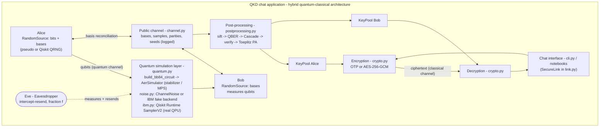

# Architecture

## 1. Mapping to the conceptual design (proposal Figure 6)

| Figure 6 block | Implementation |
|---|---|
| Alice: random qubit generation, basis selection | `RandomSource.bits()` + `encode_qubit()` (X then H) |
| Bob: random basis selection, measurement | `RandomSource.bits()` + `measure_qubit()` (H then measure) |
| Quantum channel (simulated) | `id` gate on each wire. Noise models attach errors to it |
| Quantum simulation layer (Qiskit + Aer) | `QuantumChannelSimulator.transmit()` |
| Basis reconciliation (classical channel) | `ClassicalChannel.send("bases")` + `postprocessing.sift()` |
| Shared secret key | `KeyPool` (one per party). Bits are consumed and never reused |
| Encryption / decryption modules | `OneTimePad`, `AesGcm` in `crypto.py` |
| Chat interface (Python / CLI) | `cli.py` (rich), plus `notebooks/01_BB84_walkthrough.ipynb` |

## 2. One key exchange, end to end

1. **Preparation.** Alice draws n random bits and n random bases, and Bob draws n random bases.
2. **Quantum transmission.** Qubits are packed 256 per circuit (`shots=1`, `memory=True`). Every gate
   is Clifford (X, H, measure), so Aer's **stabilizer** method simulates thousands of qubits in milliseconds.
   With Eve present, her measurement is a mid-circuit `measure` on the same wire. Because it physically
   collapses the qubit, the circuit implements intercept-resend exactly.
3. **Sifting.** Both parties announce their bases, and positions where they differ are dropped (about 50 %).
4. **Parameter estimation.** A random 25 % of the sifted bits are compared in public and discarded.
   If the QBER is above **11 %** (the BB84 limit for one-way post-processing), the exchange aborts.
5. **Error correction.** Cascade (Brassard & Salvail, 1993) runs 4 passes, with a first block size of
   about 0.73/QBER, binary search inside blocks, and back-tracking. Every parity Alice discloses is
   counted as leaked.
6. **Verification.** Alice and Bob compare a 64-bit SHA-256 tag of their keys. If the tags differ
   (usually because a small sample under-estimated the QBER), Cascade runs again with a doubled error
   estimate, up to 3 rounds, and the exchange aborts if the keys still differ.
7. **Privacy amplification.** The key is multiplied by a random Toeplitz matrix over GF(2), a
   2-universal hash family. The output length is `m = n·[1 − h(Q)] − leak_EC − 64 − 16`.
8. **Use.** Identical keys are added to both pools. OTP consumes 8 key bits per message byte, while AES
   mode derives one 256-bit session key with HKDF-SHA256.

## 3. Design decisions

| Decision | Reason |
|---|---|
| Many qubits per circuit, `shots=1` | BB84 qubits are independent. One wide circuit per 256 qubits is about 100× faster than one circuit per qubit, and it mirrors how a QPU job would be batched. |
| Stabilizer simulator by default | The circuits are Clifford, so simulation cost is polynomial rather than 2ⁿ (see E4 for the comparison with statevector and density matrix). |
| MPS simulator for IBM noise snapshots | Device noise (T1/T2 relaxation) is not Pauli, so the stabilizer method cannot be used. BB84 states are product states, so MPS stays cheap. |
| Noise attached to an explicit `id` "channel" gate | Separates channel noise from gate and readout noise, which allows controlled experiments (E2). |
| Seeds on every random source | Every experiment is reproducible with `--seed`. |
| `SecureLink` independent of the UI | The same object drives the CLI, the notebooks and the tests. |
| `QuantumChannelSimulator` and `IBMRuntimeChannel` share an interface | Moving from simulation to real hardware swaps a single object. The classical layer does not change. |

## 4. Limitations (be explicit about these in the report)

* **Authentication of the classical channel is assumed, not implemented.** BB84 needs an authenticated
  public channel, which in practice means Wegman-Carter MACs with a pre-shared key. Here Eve can read the channel but is not modelled as able to modify it.
* **Only intercept-resend is modelled.** Cloning-based and photon-number-splitting attacks (relevant to weak-pulse lasers) are out of scope.
* **Privacy amplification uses the asymptotic bound** `1 − h(Q)`. A finite-key option (`BB84Config(finite_key=True)`)
  uses a Hoeffding upper bound on the QBER instead. Full composable finite-key security analysis is out of scope.
* **"Eve's agreement after PA"** compares Eve's *naive* guess (her raw measurement results) with the final key.
  It illustrates that raw measurements do not carry through the hash, but it is not a security proof. The guarantee comes from the leftover hash lemma.
* **The one-time pad has no message authentication.** AES-GCM mode does authenticate messages.
* **Simulated randomness.** The `--qrng` option is a *real* QRNG only when it runs on hardware. On Aer it is a pseudo-RNG underneath.
* **Both parties run in one process.** A networked Alice/Bob split (sockets) is a natural extension.
* **`IBMRuntimeChannel`** was tested in Runtime local mode against fake backends, not yet against a live IBM account.
